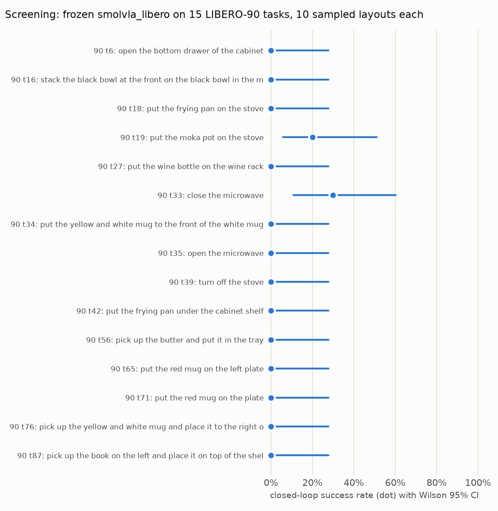

# Teaching a pretrained VLA a new manipulation skill (SmolVLA × LIBERO)

Can a pretrained vision-language-action policy learn a manipulation task it currently fails at,
from ~50 expert demonstrations? The measure is **closed-loop success in simulation**, on frozen
initial states, before vs. after fine-tuning.

- **Policy:** [SmolVLA](https://huggingface.co/papers/2506.01844) (450M parameters; VLM backbone plus
  a flow-matching action expert that predicts 50-step action chunks), via
  [LeRobot](https://github.com/huggingface/lerobot)
- **Robot / sim:** Franka Panda in [LIBERO](https://libero-project.github.io) (robosuite + MuJoCo),
  end-effector delta control at 20 Hz
- **Hardware:** a single RTX 4070 SUPER (12 GB) under WSL2

## Status

| Milestone | Status |
|---|---|
| 0. Environment and checkpoint audit: pinned stack, interface validation, success-detector check | ✅ |
| 1. Task selection and frozen baseline | ✅ |
| 2. Demonstration dataset pipeline | ⏳ next |
| 3. Fine-tuning | — |
| 4. Paired before/after evaluation, plus a forgetting check on known tasks | — |

## Experimental design

`lerobot/smolvla_libero` was fine-tuned on all 40 tasks of LIBERO-Spatial/Object/Goal/10, so none
of those tasks can show a new skill. The **target task comes from LIBERO-90**, the same benchmark,
robot and action interface, but outside the checkpoint's training set. The task was chosen by a
selection rule written down *before* screening:

> **LIBERO-90 task 56:** *"pick up the butter and put it in the tray"*

The final eval set is the task's **50 official LIBERO initial states**. They were never used for
task screening, and they are verified disjoint from the expert demonstrations' start states.

## Results so far

| Evaluation | Success (Wilson 95% CI) |
|---|---|
| In-distribution check: LIBERO-Object, 10 tasks × 5 states | **46/50 = 92%** (81–97%) |
| Screening: 15 unseen LIBERO-90 tasks × 10 sampled layouts | 5/150 = 3% (1–8%) |
| **Frozen baseline, target task, 50 held-out states** | **0/50 = 0%** (0–7.1%) |



**Baseline failure mode:** the arm reaches for familiar training objects (the ketchup and soup
cans), never approaches the butter or the tray, and toggles the gripper ~27 times per episode
(vs. ~4 on known tasks). Actions are well-formed (0.02% saturation), so this is a grounding /
generalization failure, not an interface bug. Two LIBERO-90 controls back this up: a near-duplicate
of a training task scores 5/10, while a *word-for-word* training instruction in a different scene
scores 0/10.

## Engineering findings

Most VLA deployment failures are broken interface contracts. The audit found and fixed these, each
documented with evidence in [docs/compatibility.md](docs/compatibility.md):

- **Camera key mismatch.** The checkpoint expects `camera1/2`; the env emits `image/image2`.
  LeRobot 0.6.1's eval CLI silently drops the checkpoint's saved rename map. Fixed by passing it
  explicitly and asserting it matches the saved one.
- **Replan horizon.** The checkpoint ships executing all 50 actions open-loop; replanning every 10
  is worth ~20 pp (SmolVLA paper Table 13).
- **Control rate.** Dataset metadata says 10 Hz and the train config 30 Hz, but the simulator runs
  at 20 Hz. With delta actions, a wrong rate means ~0% success.
- **Physics version.** MuJoCo ≥ 3.4 breaks stored LIBERO initial states, so it is pinned to 3.3.7.
- **Verification beyond shape checks.** Frame-0 robot state from the dataset vs. the live simulator
  (agree within mm); expert-demo replay to validate the success detector (48/50 and 49/50, with a
  no-op negative control); qpos-level train/eval leakage check.

## Reproduce

```bash
uv sync                    # Python 3.12, pinned lockfile (LeRobot v0.6.1, MuJoCo 3.3.7, torch 2.11/cu128)
uv run pytest -q           # adapter, metric, and real-checkpoint interface tests

# in-distribution check
uv run python scripts/evaluate.py --suite libero_object --task-ids 0-9 --init-states 0-4 \
    --out results/validation/libero_object_n10
# frozen baseline on the target task
uv run python scripts/evaluate.py --suite libero_90 --task-ids 56 --init-states 0-49 \
    --out results/baseline/libero_90_t56
uv run python scripts/summarize_results.py --arm baseline=results/baseline/libero_90_t56
```

Every eval directory holds per-episode records (`episodes.jsonl`: init state, success, steps,
latency, action diagnostics) and a run manifest with exact package versions and model/data
revisions. Videos are written locally per episode and are not committed.

## Repository layout

```
configs/            eval settings shared by all arms; checkpoint pin; frozen task + eval set
src/vla_sim_poc/    env wrapper, observation/action adapters, policy loader, rollout loop, statistics
scripts/            inspect_{env,checkpoint,dataset}, replay_demos, evaluate, summarize_results
tests/              adapter/metric unit tests + real-checkpoint interface tests
docs/               compatibility audit · experiment log (decisions, pre-registration) · results
results/            per-episode JSONL, summaries, plots
```

## Docs

- [docs/compatibility.md](docs/compatibility.md): pinned stack, observation/action schemas, the
  discrepancies found, and the evidence for each gate
- [docs/experiment_log.md](docs/experiment_log.md): design decisions, pre-registered task selection,
  screening, controls
- [docs/results.md](docs/results.md): baseline metrics and failure analysis
