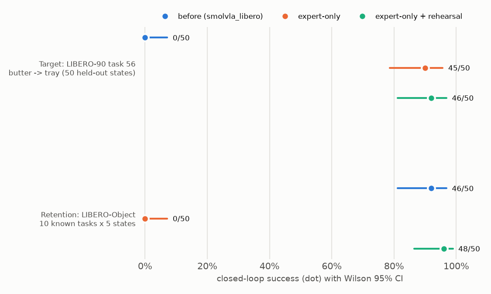

# Teaching a pretrained VLA a new manipulation skill (SmolVLA × LIBERO)

Can a pretrained vision-language-action policy learn a manipulation task it currently fails at,
from ~50 expert demonstrations? The measure is **closed-loop success in simulation**, on frozen
initial states, before vs. after fine-tuning.

- **Policy:** [SmolVLA](https://huggingface.co/papers/2506.01844) (450M parameters; VLM backbone plus
  a flow-matching action expert that predicts 50-step action chunks), via
  [LeRobot](https://github.com/huggingface/lerobot)
- **Robot / sim:** Franka Panda in [LIBERO](https://libero-project.github.io) (robosuite + MuJoCo),
  end-effector delta control at 20 Hz
- **Hardware:** a single RTX 4070 SUPER (12 GB) under WSL2

## Status

| Milestone | Status |
|---|---|
| 0. Environment and checkpoint audit: pinned stack, interface validation, success-detector check | ✅ |
| 1. Task selection and frozen baseline | ✅ |
| 2. Demonstration dataset pipeline: 50 demos regenerated and verified | ✅ |
| 3. Fine-tuning: action expert only, without and with rehearsal (local GPU, $0) | ✅ |
| 4. Paired before/after evaluation + forgetting check | ✅ |

## Experimental design

`lerobot/smolvla_libero` was fine-tuned on all 40 tasks of LIBERO-Spatial/Object/Goal/10, so none
of those tasks can show a new skill. The **target task comes from LIBERO-90**, the same benchmark,
robot and action interface, but outside the checkpoint's training set. The task was chosen by a
selection rule written down *before* screening:

> **LIBERO-90 task 56:** *"pick up the butter and put it in the tray"*

The final eval set is the task's **50 official LIBERO initial states**. They were never used for
task screening, and they are verified disjoint from the expert demonstrations' start states.

## Results

All numbers are closed-loop success in simulation with Wilson 95% CIs. Every arm is evaluated **on
identical initial states**, and comparisons are paired.

| Evaluation | Before (`smolvla_libero`) | Fine-tuned: action expert only | **Fine-tuned: action expert + rehearsal** |
|---|---|---|---|
| **Target: LIBERO-90 task 56, 50 held-out states** | 0/50 = 0% | 45/50 = 90% | **46/50 = 92%** (81–97%) |
| **Retention: LIBERO-Object, 10 known tasks × 5 states** | 46/50 = 92% | 0/50 = 0% | **48/50 = 96%** (87–99%) |



- **New skill, old skills kept.** Fine-tuning only the 100M-parameter action expert (VLM frozen)
  on 45 demos, with 50% of each batch drawn from the checkpoint's original training data, takes the
  new task from 0% to 92% (+92 pp, McNemar p = 3e-14). Retention on known tasks shows no measurable
  change. Each run takes 1.5–2 GPU-hours on an RTX 4070 SUPER ($0).
- **Without rehearsal, the model forgets.** Training on the new task alone also reaches 90%, but
  known-task success collapses from 92% to 0%, even with the VLM frozen. The forgetting happens in
  the action expert and is caused by the training distribution, not by which parameters are trained.
- **Failure modes change in kind.** The baseline reaches for familiar training objects
  (`missed_object`, ~27 gripper toggles/episode). Fine-tuned policies go to the butter and finish in
  ~4.5 s with ~2 toggles; their remaining failures are slipped grasps (`no_grasp`).
- **Offline loss is a poor guide.** Held-out-demo loss is lowest at step 250 and then rises, while
  closed-loop success stays at 95–100% ([training curves](results/plots/training_expert_only_rehearsal.png)).
  Checkpoints are chosen by pre-registered closed-loop selection on episodes disjoint from the test set.

Context: the in-distribution check (92% on LIBERO-Object) validates the pipeline. Screening 15 unseen
LIBERO-90 tasks gave 5/150, and task 56 was then chosen by a selection rule written before
screening. Details: [docs/results.md](docs/results.md), [docs/experiment_log.md](docs/experiment_log.md).

## Engineering findings

Most VLA deployment failures are broken interface contracts. The audit found and fixed these, each
documented with evidence in [docs/compatibility.md](docs/compatibility.md):

- **Camera key mismatch.** The checkpoint expects `camera1/2`; the env emits `image/image2`.
  LeRobot 0.6.1's eval CLI silently drops the checkpoint's saved rename map. Fixed by passing it
  explicitly and asserting it matches the saved one.
- **Replan horizon.** The checkpoint ships executing all 50 actions open-loop; replanning every 10
  is worth ~20 pp (SmolVLA paper Table 13).
- **Control rate.** Dataset metadata says 10 Hz and the train config 30 Hz, but the simulator runs
  at 20 Hz. With delta actions, a wrong rate means ~0% success.
- **Physics version.** MuJoCo ≥ 3.4 breaks stored LIBERO initial states, so it is pinned to 3.3.7.
- **Training data built through the eval code path.** The 50 task-56 demos are replayed from the
  official HDF5 through the same observation code used at eval. Stored frames are byte-identical to
  a re-simulation, and all 50 episodes match an independent third-party conversion action for action
  ([docs/dataset.md](docs/dataset.md)).
- **Robust, resumable training.** Training saves a resumable checkpoint every 30 min, at every
  eval checkpoint, on SIGTERM/Ctrl+C, and on crashes. A real crash (a torchcodec decoder cached in a
  data-loader worker going bad after many random seeks) is now retried with a fresh decoder.
- **Silent normalization swap.** `lerobot-train` replaces the checkpoint's normalization stats with
  the fine-tuning set's. For a single task that rescales state inputs up to 10×, so we keep the
  checkpoint's stats.
- **Verification beyond shape checks.** Frame-0 robot state from the dataset vs. the live simulator
  (agree within mm); expert-demo replay to validate the success detector (48/50 and 49/50, with a
  no-op negative control); qpos-level train/eval leakage check.

## Reproduce

```bash
uv sync                    # Python 3.12, pinned lockfile (LeRobot v0.6.1, MuJoCo 3.3.7, torch 2.11/cu128)
uv run pytest -q           # adapter, metric, and real-checkpoint interface tests

# in-distribution check
uv run python scripts/evaluate.py --suite libero_object --task-ids 0-9 --init-states 0-4 \
    --out results/validation/libero_object_n10
# frozen baseline on the target task
uv run python scripts/evaluate.py --suite libero_90 --task-ids 56 --init-states 0-49 \
    --out results/baseline/libero_90_t56
# build the target-task dataset from the official LIBERO demos, then fine-tune the action expert
uv run python scripts/prepare_dataset.py
uv run python scripts/train.py --config configs/train_expert_only_rehearsal.yaml   # or train_expert_only.yaml
#   graceful stop: kill -TERM $(cat outputs/train/<run>/train.pid);  continue: add --resume
# evaluate the selected checkpoint on the same 50 states, and on the known suite (forgetting)
uv run python scripts/evaluate.py --configs eval.yaml finetuned_expert_only_rehearsal.yaml \
    --suite libero_90 --task-ids 56 --init-states 0-49 --out results/finetuned/expert_only_rehearsal_s0/libero_90_t56
uv run python scripts/summarize_results.py --arm baseline=results/baseline/libero_90_t56 \
    --arm finetuned=results/finetuned/expert_only_rehearsal_s0/libero_90_t56
```

Every eval directory holds per-episode records (`episodes.jsonl`: init state, success, steps,
latency, action diagnostics) and a run manifest with exact package versions and model/data
revisions. Videos are written locally per episode and are not committed.

## Repository layout

```
configs/            eval settings shared by all arms; checkpoint pin; frozen task + eval set
src/vla_sim_poc/    env wrapper, observation/action adapters, policy loader, rollout loop, statistics
scripts/            data: prepare_dataset, crosscheck_reference_dataset, check_training_batch, replay_demos
                    train, evaluate, summarize_results, plot_*; inspect_* (M0 audit)
tests/              adapter/metric unit tests + real-checkpoint interface tests
docs/               compatibility audit · experiment log (decisions, pre-registration) · results
results/            per-episode JSONL, summaries, plots
```

## Docs

- [docs/compatibility.md](docs/compatibility.md): pinned stack, observation/action schemas, the
  discrepancies found, and the evidence for each gate
- [docs/experiment_log.md](docs/experiment_log.md): design decisions, pre-registered task selection,
  screening, controls
- [docs/dataset.md](docs/dataset.md): target-task dataset build, verification, normalization analysis
- [docs/results.md](docs/results.md): baseline metrics and failure analysis
