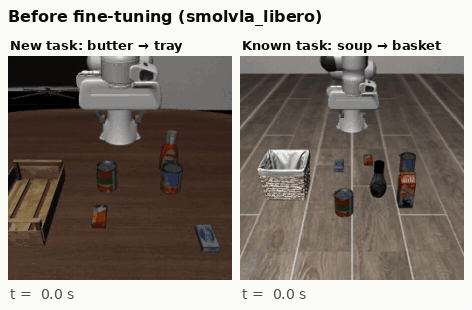
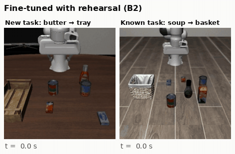
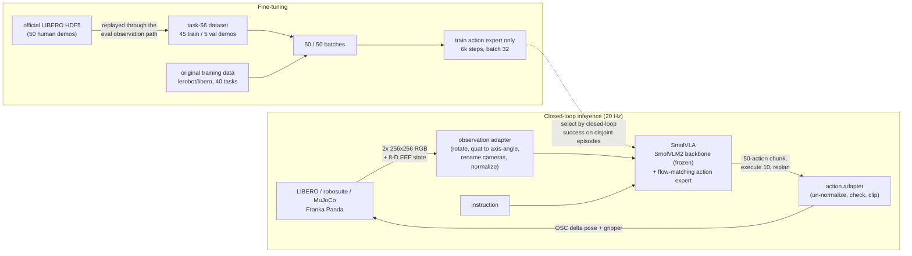

# Teaching a pretrained VLA a new manipulation skill without forgetting the old ones

Fine-tuning [SmolVLA](https://huggingface.co/papers/2506.01844) (a 450M-parameter vision-language-action
policy) on 45 demonstrations of a task it fails at, in the [LIBERO](https://libero-project.github.io)
simulator, evaluated by closed-loop rollouts on frozen, paired initial states.

**TL;DR**
- The pretrained policy solves its known tasks (**92%**) but fails the new one, *"pick up the butter
  and put it in the tray"* (**0/50**).
- Fine-tuning only its action expert on the new demos teaches the skill (**90%**) but **erases the
  old ones (92% → 0%)**, even with the vision-language backbone frozen.
- Mixing the original training data back in (50% rehearsal) gives both: **92% on the new task, 96%
  on known tasks**. Each run takes ~1.5 h, trained on a local RTX 4070 SUPER.

## Demo

Same starting states for all three policies. Left: the new task. Right: a task the original policy
already knows. Third-person camera, 2× speed.

**Before fine-tuning:** knows the old task, fails the new one (reaches for the familiar cans).



**Fine-tuned on the new task only:** learns the new task, forgets the old one (the same reach
regardless of the instruction).


**Fine-tuned with rehearsal:** learns the new task and keeps the old one.



## Results

Closed-loop success in simulation (Wilson 95% CIs). Every policy is evaluated on **identical initial
states**, and comparisons are paired.

| Evaluation | Before (`smolvla_libero`) | Fine-tuned: new task only | **Fine-tuned: + rehearsal** |
|---|---|---|---|
| **New task:** LIBERO-90 task 56, 50 held-out states | 0/50 = 0% | 45/50 = 90% | **46/50 = 92%** (81–97%) |
| **Known tasks:** LIBERO-Object, 10 tasks × 5 states | 46/50 = 92% | 0/50 = 0% | **48/50 = 96%** (87–99%) |


- **New skill, old skills kept.** Rehearsal fine-tuning takes the new task from 0% to 92%
  (+92 pp, exact McNemar p = 3e-14), with no measurable change on known tasks (p = 0.5) and no
  measurable cost on the new task vs. training without rehearsal (p = 1.0).
- **Forgetting is caused by the data, not the parameters.** Both fine-tunes update only the
  100M-parameter action expert, with the VLM frozen. Without rehearsal the expert collapses to a
  single behaviour; a light replay of the original data (~0.35 passes over it) prevents that.
- **Failure modes change in kind.** Before: wrong target (`missed_object`, ~27 gripper toggles per
  episode). After: the policy goes to the butter and finishes in ~4.5 s with ~2 toggles, and the
  remaining failures are slipped grasps (`no_grasp`).
- **Offline loss is a poor guide to closed-loop success.** Held-out-demo loss is lowest after ~250
  steps and then rises, while rollout success stays at 95–100%
  ([training curves](results/plots/training_expert_only_rehearsal.png)). Checkpoints are therefore
  selected by pre-registered closed-loop evaluation on episodes disjoint from the test set.

## How it works



- **Task choice.** `lerobot/smolvla_libero` was trained on all 40 LIBERO-Spatial/Object/Goal/10
  tasks, so the new task comes from **LIBERO-90**: the same robot, cameras and action interface, but
  outside the checkpoint's training set. It was picked from 15 unseen candidates (5/150 screening
  successes) by a selection rule written down before screening.
- **Evaluation protocol.** Final numbers use the task's 50 official LIBERO initial states, which
  were never used for screening, training or checkpoint selection, and are verified disjoint from
  the demo start states. Closed-loop success is the only metric; offline loss is never used as a
  substitute.
- **Training.** A minimal loop on LeRobot components (`scripts/train.py`). It keeps the
  checkpoint's normalization stats, mixes rehearsal data by weighted sampling, logs held-out-demo and
  known-task losses, and checkpoints resumably (every 30 min, on SIGTERM/Ctrl+C, and on crashes).

## Engineering findings

Most VLA deployment failures are broken interface contracts. The audit
([docs/compatibility.md](docs/compatibility.md)) found and fixed these:

- **Camera key mismatch.** The checkpoint expects `camera1/2`, the env emits `image/image2`, and
  LeRobot 0.6.1's eval CLI silently drops the checkpoint's saved rename map.
- **Replan horizon.** The checkpoint ships executing all 50 predicted actions open-loop; replanning
  every 10 is worth ~20 pp.
- **Control rate.** Metadata says 10 Hz (dataset) and 30 Hz (train config), but the sim runs at
  20 Hz. With delta actions, a wrong rate means ~0% success.
- **Physics version.** MuJoCo ≥ 3.4 breaks stored LIBERO initial states, so it is pinned to 3.3.7.
- **Silent normalization swap.** `lerobot-train` replaces the checkpoint's normalization stats with
  the fine-tuning set's. For one task that rescales state inputs up to 10×, so the checkpoint's stats
  are kept.
- **Training data verified, not assumed.** The demos are replayed through the eval observation code.
  Stored frames are byte-identical to a re-simulation, and all 50 episodes match an independent
  third-party conversion action for action ([docs/dataset.md](docs/dataset.md)).
- **WSL2 memory spill.** Full fine-tuning at batch 16 "fits" in 12 GB only because the driver spills
  to system RAM, running 15× slower instead of failing.
- **A real training crash, root-caused.** A torchcodec decoder cached in a data-loader worker goes
  bad after many random seeks. Retries now get a fresh decoder, and any crash saves a resumable
  checkpoint first.

## Hardware

| | |
|---|---|
| GPU | local RTX 4070 SUPER 12 GB (WSL2, Ubuntu 22.04), used for all training and evaluation |
| Training, per run | 6,000 steps, 1.5–2 h, 8.3 GB peak |
| Evaluation | ~8–25 min per 50 episodes; ~360 ms per 50-action chunk inference |

## Limitations

- One training seed per arm, and policy sampling noise was not seeded per evaluation episode, so
  per-state outcomes are single stochastic draws (rates and CIs remain valid).
- Within a LIBERO task the scene barely varies (objects jitter within 5 × 5 cm, fixed rotations).
  92% means mastering one layout, not robustness to new layouts, lighting or cameras.
- Retention is measured on one known suite (LIBERO-Object, 50 episodes). Simulation only.

## Reproduce

```bash
uv sync                    # Python 3.12, pinned lockfile (LeRobot v0.6.1, MuJoCo 3.3.7, torch 2.11/cu128)
uv run pytest -q           # adapter, dataset, metric, training-utility and real-checkpoint tests

# baseline: known suite and new task
uv run python scripts/evaluate.py --suite libero_object --task-ids 0-9 --init-states 0-4 --out results/validation/libero_object_n10
uv run python scripts/evaluate.py --suite libero_90 --task-ids 56 --init-states 0-49 --out results/baseline/libero_90_t56

# dataset from the official LIBERO demos, then fine-tune (with rehearsal)
uv run python scripts/prepare_dataset.py
uv run python scripts/train.py --config configs/train_expert_only_rehearsal.yaml
#   graceful stop: kill -TERM $(cat outputs/train/<run>/train.pid);  continue: add --resume

# evaluate the selected checkpoint on the same states, then compare
uv run python scripts/evaluate.py --configs eval.yaml finetuned_expert_only_rehearsal.yaml \
    --suite libero_90 --task-ids 56 --init-states 0-49 --out results/finetuned/expert_only_rehearsal_s0/libero_90_t56
uv run python scripts/summarize_results.py --arm baseline=results/baseline/libero_90_t56 \
    --arm finetuned=results/finetuned/expert_only_rehearsal_s0/libero_90_t56
uv run python scripts/make_demo_gifs.py   # README GIFs from the rollout videos
```

Every eval directory holds per-episode records (`episodes.jsonl`: initial state, success, steps,
latency, action diagnostics) and a run manifest with exact package versions and model/data revisions.

```
configs/            shared eval settings · checkpoint pins · frozen task + eval set · training configs
src/vla_sim_poc/    env wrapper, observation/action adapters, policy loader, rollout, dataset, training, statistics
scripts/            prepare_dataset, train, evaluate, summarize_results, plots/GIFs; inspect_* and replay_demos (audit)
tests/              adapters, temporal alignment, splits, metrics, training utilities, real-checkpoint interface
docs/               compatibility audit · dataset · experiment log (decisions, pre-registration) · results
```

**Further reading:** [docs/results.md](docs/results.md) (full results and failure analysis) ·
[docs/experiment_log.md](docs/experiment_log.md) (decisions, pre-registered protocols, incidents) ·
[docs/dataset.md](docs/dataset.md) · [docs/compatibility.md](docs/compatibility.md)
