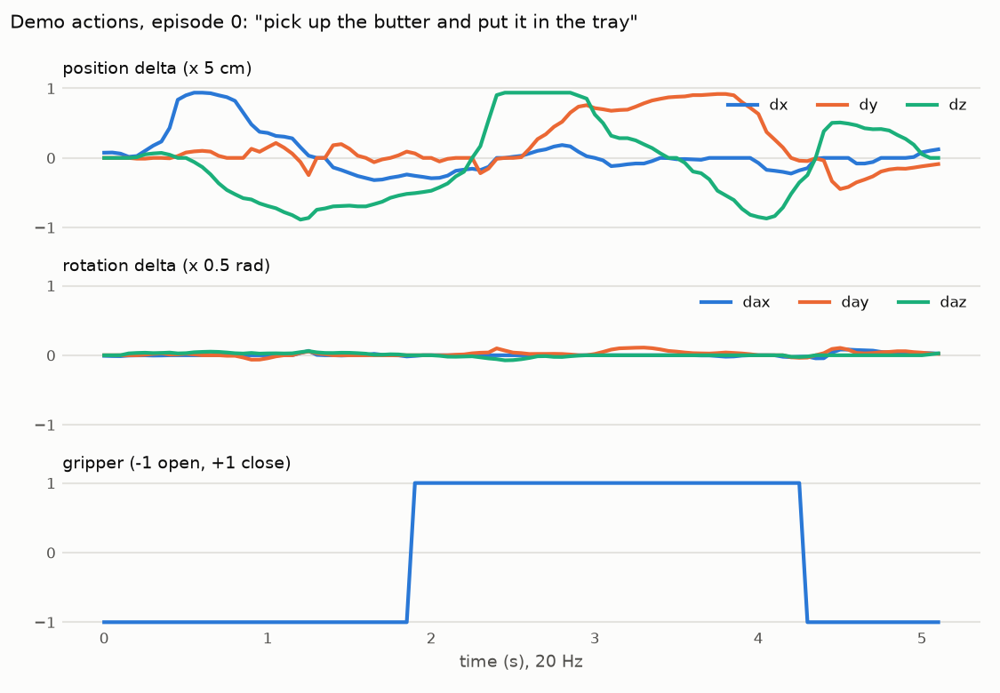

# Target-task dataset (Milestone 2)

**LIBERO-90 task 56**, *"pick up the butter and put it in the tray"*: 50 expert demonstrations
regenerated into a LeRobot v3 dataset through the **same observation code path the policy uses at
evaluation**.

## Source and build

| | |
|---|---|
| Source demos | official LIBERO HDF5, `yifengzhu-hf/LIBERO-datasets@f13aa24a`, `libero_90/LIVING_ROOM_SCENE3_pick_up_the_butter_and_put_it_in_the_tray_demo.hdf5` (50 human teleoperated demos) |
| Build | `scripts/prepare_dataset.py` (`src/vla_sim_poc/dataset.py`) |
| Output | `data/lerobot/libero90_t56/` (git-ignored, 622 MB): 50 episodes, 5,027 frames, fps 20, PNG images |
| Episode length | mean 100.5 frames (85-126), i.e. ~5 s at 20 Hz |
| Split | episode-level, seed 0: 45 train / 5 val (val episodes 2, 4, 18, 23, 36), `vla_sim_poc/split.json` |

Recipe (the one behind `lerobot/libero`, the checkpoint's training data, from OpenVLA's
`regenerate_libero_dataset.py`):

1. `reset()` → `set_init_state(demo.states[0])` → 10 no-op settle steps, exactly as `LiberoEnv.reset` does at eval.
2. For each recorded action: drop no-ops (arm delta < 1e-4 *and* gripper unchanged; 42 dropped
   across 11 demos). Otherwise **record the observation, then step the action**, so frame *t*
   pairs with the action chosen from it.
3. Keep the demo only if the replay ends in success: **50/50 kept**. (A plain replay without the
   settle steps and no-op filter succeeded on only 49/50.)

Observations pass through `LiberoEnv._format_raw_obs` → `raw_to_policy_frame`: 180° rotation,
`[eef_pos, axis-angle, gripper_qpos]` state, keys `observation.images.image/image2`. That is the
same schema and convention as `lerobot/libero`, and the checkpoint's own preprocessor renames to
`camera1/2`.

**Differences from `lerobot/libero`, all deliberate:**
- images stored lossless (PNG) rather than AV1 video, so training frames equal eval frames bit for bit;
- `fps` metadata is the true 20 Hz, not 10;
- frames are rendered by the same renderer used at eval.

## Verification

| Check | Result | Evidence |
|---|---|---|
| Cross-check vs independent conversion (`jesbu1/libero_90_lerobot`, OpenVLA → RLDS → LeRobot) | **50/50 episodes matched by identical action sequences**; state diff median 1e-5, max 9e-4; image mean abs diff 1.8/255 (45.6 if rotated 180°, so orientation agrees) | `results/dataset/crosscheck_reference.json`, `crosscheck_ours_ref_diffx4.png` |
| Temporal alignment | replaying the original actions from the demo start reproduces every stored state (±1e-5) and **every stored image byte for byte** *before* the action at that index | `tests/test_temporal_alignment.py` |
| Labels | float32 labels equal the no-op-filtered originals to 1e-7; arm dims within [-1,1]; gripper ∈ {-1,+1} | same |
| Schema / instruction | 8-D state, 7-D action, 2× 256×256×3, fps 20, exactly one task string identical to the eval instruction | same |
| Exit gate | batch of 8 loads with 50-step action chunks (padding flagged past episode end), forwards through `smolvla_libero`, finite loss | `scripts/check_training_batch.py` → `results/dataset/batch_check.json` |

Subtle finding: replaying the **float32** labels instead of the float64 originals changes a few
wrist-camera pixels by one level (3e-8 action rounding moves the arm-mounted camera). The dataset is
exact; the test replays the originals and separately bounds the rounding.

## What the checkpoint thinks of this data

Flow-matching loss of the frozen checkpoint, with its own normalization and identical noise/time
draws (16 batches × 8):

| Data | Loss |
|---|---|
| libero_object task 0 (in its training set) | 0.068 ± 0.013 |
| **LIBERO-90 task 56 (target, train split)** | **4.41 ± 0.29** (65× higher) |

This is the offline counterpart of the 0/50 closed-loop baseline. Milestone 4 judges the result on
closed-loop success only, never on this loss.

A demo is a single grasp (gripper closes once at ~1.9 s, opens at ~4.3 s) with almost no rotation.
The frozen policy toggles the gripper ~27 times per episode on this task.

## Normalization: the decision for Milestone 3

`lerobot-train`, when fine-tuning from a pretrained checkpoint, **replaces the checkpoint's
normalization stats with the new dataset's** (`lerobot_train.py` L371-377; only `--resume` keeps
them). Measured shift of this task's stats relative to the checkpoint's
(`vla_sim_poc/stats_vs_checkpoint.json`):

| | mean shift (checkpoint std units) | std ratio (new / checkpoint) |
|---|---|---|
| state (8 dims) | 0.01 – 0.71 | **0.10 – 0.69** |
| action (7 dims) | 0.00 – 0.28 | 0.37 – 1.25 |

Single-task state variance is up to **10× smaller** than the 40-task variance, so re-normalizing
would amplify state inputs 1.5–10× for the pretrained weights from step 0, and change the scale of
every predicted action. Plan: **keep the checkpoint's stats** for both state and action, so the
fine-tuned policy reads and writes the same units as the pretrained one. The only change is then the
data, which is the variable under test.
