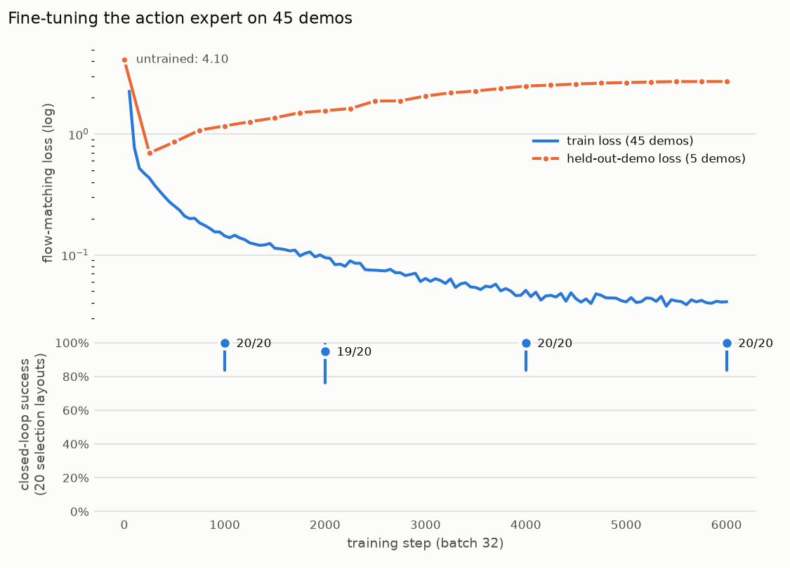
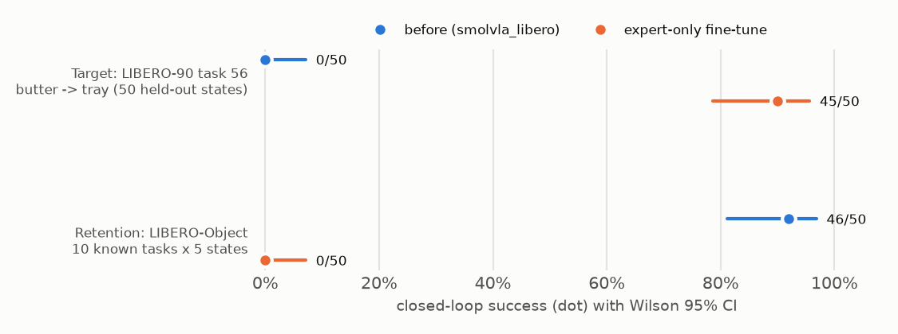

# Results

## Arm A: frozen baseline (Milestone 1)

**Task:** `libero_90` task 56, LIVING_ROOM_SCENE3, *"pick up the butter and put it in the tray"*
(selected by the pre-registered rule; see `docs/experiment_log.md`).
**Policy:** `lerobot/smolvla_libero@a24f1f38`, unchanged weights.
**Eval set:** the 50 official LIBERO init states (0-49), env seed 1000, 400-step limit. None of these
states was used for screening, and no demo starts at one of them (`replay_demos.py` leakage check).

| Metric | Value |
|---|---|
| **Success** | **0/50 = 0.0% (Wilson 95% CI 0.0%-7.1%)** |
| Terminations | 50/50 timeout at 400 steps |
| Inference settings | chunk_size 50, **n_action_steps 10**, 10 flow-matching steps, bf16 weights, CUDA, 256x256 cameras, 20 Hz |
| Chunk inference latency | mean 393 ms, p95 579 ms (RTX 4070 SUPER, WSL2, run alone) |
| Eval cost | 23.9 min wall total for 50 episodes (28.6 s/episode), local GPU, $0 |
| Arm saturation (any of dims 0-5 outside [-1,1]) | 0.02% of 20,000 steps |
| Gripper sign switches per episode | mean 26.6 (min 8, max 65); in-distribution validation episodes average 4.3 |

Per-episode records: `results/baseline/libero_90_t56/episodes.jsonl`. Videos (every episode):
`results/baseline/libero_90_t56/videos/`. Raw actions: `.../actions/*.npy`. Run manifest:
`.../run_config_*.json`.

### Failure analysis (preliminary, 6 of 50 episodes reviewed by eye)

Init states 0, 7, 13, 21, 34 and 46, all tagged **`missed_object`**. The arm leaves home and moves
to the back-right of the table, where the **ketchup and alphabet soup** stand (libero_object training
objects, simulator positions around x≈-0.11..-0.23, y≈-0.17). It never approaches the butter at
(0.035, 0.057) or the tray at y=0.26, then hovers there with the gripper toggling. Actions are not
degenerate (no saturation, mean |Δpos| ≈ 0.19). The failure is **target grounding**: the policy acts
out the familiar "pick a can" behaviour from its training distribution instead of following the
instruction. In our failure taxonomy this is *model generalization* (perception/language
grounding), not an action-interface or control problem: the same interface reaches 92% in
distribution.

Supporting context (screening, not final results):
* 15 LIBERO-90 candidates: 5/150 (3%). Successes only on sub-skills of libero_10 training tasks.
* Positive controls: near-duplicate training task (alphabet soup -> basket) 5/10. Word-for-word
  training instruction in a different scene ("turn on the stove") 0/10.
* In-distribution validation (libero_object): 46/50 = 92% (81-97%).

**Interpretation:** under our evaluation the checkpoint does not perform this skill (0/50, true rate
<= 7.1% at 95% confidence). This does **not** show the skill is absent from pretraining. It is the
starting point for Milestone 3: can 50 expert demos move this number?

## Arm B1: action-expert-only fine-tune (Milestones 3-4)

**Training** (`configs/train_expert_only.yaml`, `scripts/train.py`, logs in `results/train/expert_only_s0/`):
init `smolvla_libero@a24f1f38`; VLM + vision encoder frozen, 99.9M of 450M parameters trained;
45 demos (4,517 frames); batch 32; 6,000 steps; SmolVLA AdamW/cosine presets (lr 1e-4, warmup 200);
checkpoint normalization stats. 122 min on the local RTX 4070 SUPER, 8.3 GB peak, **$0**.

Held-out-demo loss bottoms out at step ~250 (0.70) and then rises to 2.7 while train loss keeps
falling: the expert memorises 45 demos. Closed-loop success on the selection layouts nevertheless
stays at 19-20/20 for every checkpoint, a live example of offline loss and rollout success
disagreeing. Selection (pre-registered): steps 1000/4000/6000 tie at 20/20; the lowest held-out loss
picks **step 1000**.

**Frozen evaluation** (selected checkpoint, same 50 official init states, seed and settings as arm A):

| | Arm A: frozen baseline | **Arm B1: expert-only fine-tune** |
|---|---|---|
| Target task 56 (50 held-out states) | 0/50 = 0% (0-7%) | **45/50 = 90% (79-96%)** |
| Paired change | | **+90 pp** (bootstrap 95% CI +80 to +98); 45 failure→success, 0 success→failure; exact McNemar p = 6e-14 |
| Retention: LIBERO-Object (10 tasks x 5 states) | 46/50 = 92% (81-97%) | **0/50 = 0% (0-7%)** |
| Paired change (retention) | | **−92 pp** (−98 to −84); 46 success→failure, 0 reverse; p = 3e-14 |
| Successful-episode length | — | mean 85 steps (70-106), 4.3 s; demos average 100 frames |
| Gripper switches / episode (target) | 26.6 | 2.1 on successes, 33 on failures |
| Chunk inference latency | 393 ms | 358 ms (mean), 460 ms p95 |

**Target-task failures (5/50; init states 17, 24, 33, 34, 46):** all `no_grasp`. The arm now goes
to the butter (the wrist camera shows the box at close range), but the grasp fails: the box is tipped
or slips, and the arm either keeps re-attempting with the gripper toggling or carries an empty
gripper to the tray. This is a qualitatively different failure from the baseline's `missed_object`.
Fine-tuning fixed target selection and motion; residual errors are grasp execution.

**Catastrophic forgetting:** on LIBERO-Object scenes the fine-tuned policy performs a stereotyped
forward reach toward the middle of the table regardless of the named object, with gripper dithering
(28 switches/episode vs 4.3 before). The VLM was frozen, so the visual and language features are
unchanged; the action expert has learned to ignore them. Hypothesis (untested): with a single
scene and a single instruction in training, the expert leans on the proprioceptive state, which
differs sharply between scenes (EEF height ~0.26 m on the LIBERO-Object floor vs ~0.57 m on this
tabletop).

**Interpretation:** 45 demonstrations and 2 GPU-hours teach the frozen-perception model this skill
(0% → 90%), so updating only the action expert is enough to *acquire* the skill. Training on the
target task alone **replaces** the previous competence rather than adding to it. Freezing the VLM
does not protect against this, because the forgetting happens in the action expert itself.
